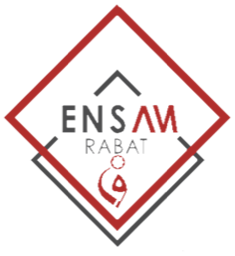

<p align="center">
  
  &nbsp;&nbsp;&nbsp;
  
</p>

# Jumeau numérique d'une ligne de production

Mini-projet Industrie 4.0, ENSAM Rabat, filière INDIA&SD, 2026/2027, encadré par **Prof. Maria Zemzami**.

Ligne simplifiée à 4 postes : **Alimentation (5 s) → Traitement (8 s) → Contrôle qualité (15 s) → Emballage (7 s)**, avec convoyeur, files d'attente, pannes aléatoires et rejets.

- **Backend Python** (`backend/`) : simulation de la ligne (files, blocages, pannes, rejets) et diffusion en temps réel par WebSocket.
- **Scène 3D Unity** (`unity/`) : la ligne animée, en build WebGL dans le navigateur. Elle lit le flux du backend et interpole les mouvements pour rester fluide.
- **Tableau de bord web** (`frontend/`) : KPI, états des postes, graphes, pilotage des scénarios d'optimisation, comparaison avant et après, historique.
- **Historique SQLite** (`backend/storage.py`) : un relevé des KPI par minute simulée, événements, export CSV.
- **Validation** (`tests/`) : 23 tests pytest (débit théorique, conservation, capacité des files, pannes, API).

## Documents

| Document | Fichier |
|---|---|
| Cahier des charges | [`docs/cahier-des-charges.md`](docs/cahier-des-charges.md) |
| Résultats mesurés avec la scène Unity | [`docs/resultats-unity.md`](docs/resultats-unity.md) |
| Protocole WebSocket | [`docs/protocole-websocket.md`](docs/protocole-websocket.md) |
| Manuel utilisateur | [`docs/manuel-utilisateur.md`](docs/manuel-utilisateur.md) |
| Rapport (LaTeX, mesures faites avec la scène Unity) | [`docs/rapport/rapport.pdf`](docs/rapport/rapport.pdf) |

## Équipe

| Membre | Responsabilité | Code |
|---|---|---|
| Aymane ISSAMI | 3D et architecture | `unity/Assets/Scripts/Scene/` |
| Marouan EZBAKHE | 3D et animation | `unity/Assets/Scripts/Scene/` |
| Hiba BENZAHRA | Simulation industrielle | `backend/sim.py` |
| Zaid HSAIN | Backend et communication | `backend/server.py`, `backend/storage.py`, `unity/Assets/Scripts/Net/` |
| Houssam KICHCHOU | Dashboard et KPI | `frontend/` |
| Mohamed HAMDOUCH | Optimisation et validation | `compare_presets`, `tests/`, `unity/Assets/Scripts/Bench/` |

## Lancer

Python 3.9 ou plus :

```bash
python -m venv .venv
source .venv/bin/activate        # Windows : .venv\Scripts\activate
pip install -r requirements.txt
python backend/server.py
```

Ouvrir <http://localhost:8000>. Aucune connexion Internet n'est nécessaire.

### Générer la scène 3D (build WebGL)

Le build WebGL n'est pas versionné (il pèse plusieurs dizaines de Mo). Pour le générer :

1. Installer Unity Hub, puis **Unity 6 (6000.6)** avec le module **Web Build Support**.
2. Ouvrir le dossier `unity/` avec Unity.
3. Menu **Twin > Construire la scène** (une seule fois, ou si la scène est modifiée).
4. Menu **Twin > Construire WebGL**. Le résultat est écrit dans `frontend/unity/`.
5. Recharger la page du backend.

Sans ce build, le tableau de bord fonctionne et affiche un message à la place de la scène.

### Tests

```bash
python -m pytest -q
```

## Architecture

```
 navigateur                                          backend Python
┌────────────────────────────────────┐  WebSocket  ┌────────────────────────┐
│ Scène Unity WebGL  (3D, interpolée)│ ◀── état ── │ server.py (FastAPI)    │
│ Tableau de bord    (KPI, scénarios)│ ─ commandes▶│ sim.py    (simulation) │
└────────────────────────────────────┘    /ws      │ storage.py (SQLite)    │
                                                   └────────────────────────┘
```

Le backend fait avancer la simulation par pas de 0,05 s simulée et envoie l'état complet 10 fois par seconde. La scène 3D et le tableau de bord lisent **le même flux**, donc ils restent synchronisés. Le détail des messages est dans [`docs/protocole-websocket.md`](docs/protocole-websocket.md).

| Élément | Rôle |
|---|---|
| `backend/sim.py` | Logique de la ligne, pannes, KPI, comparaison de scénarios |
| `backend/server.py` | Serveur WebSocket, commandes, diffusion, graine facultative `SIM_SEED` |
| `unity/Assets/Scripts/Net/` | Client WebSocket (éditeur et navigateur), tampon d'états, interpolation |
| `unity/Assets/Scripts/Scene/` | Machines, convoyeur, produits recyclés, étiquettes, caméra orbitale |
| `unity/Assets/Scripts/Bench/` | Banc d'essai : joue chaque scénario et enregistre les mesures |
| `unity/Assets/Editor/` | Menus Twin : construire la scène, banc d'essai, build WebGL |
| `frontend/` | Tableau de bord et page qui héberge le build Unity |

## Scénarios d'optimisation

| Scénario | Réglage | Effet attendu |
|---|---|---|
| Situation initiale | contrôle 15 s | goulot au contrôle, 4 produits/min au maximum |
| Contrôle automatisé | contrôle 8 s | goulot déplacé au traitement, 7,5 produits/min au maximum |
| 2 postes de contrôle | 2 × 15 s en parallèle | 7,5 produits/min au maximum |
| Convoyeur adaptatif | files limitées à 3, convoyeur ralenti devant une file chargée | même débit, moins d'en-cours |

Les résultats mesurés avec la scène Unity sont dans [`docs/resultats-unity.md`](docs/resultats-unity.md). Pour les reproduire : lancer le backend avec `SIM_SEED=7`, ouvrir le projet Unity, menu **Twin > Lancer le banc d'essai** (environ 25 minutes).

Les paramètres de la ligne (temps de cycle, pannes, files, rejets) sont dans `DEFAULT_CONFIG` (`backend/sim.py`).
